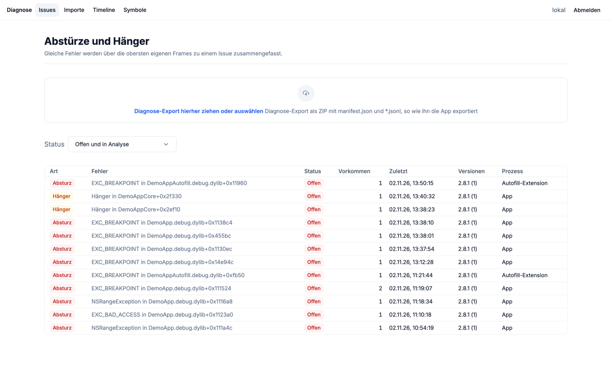
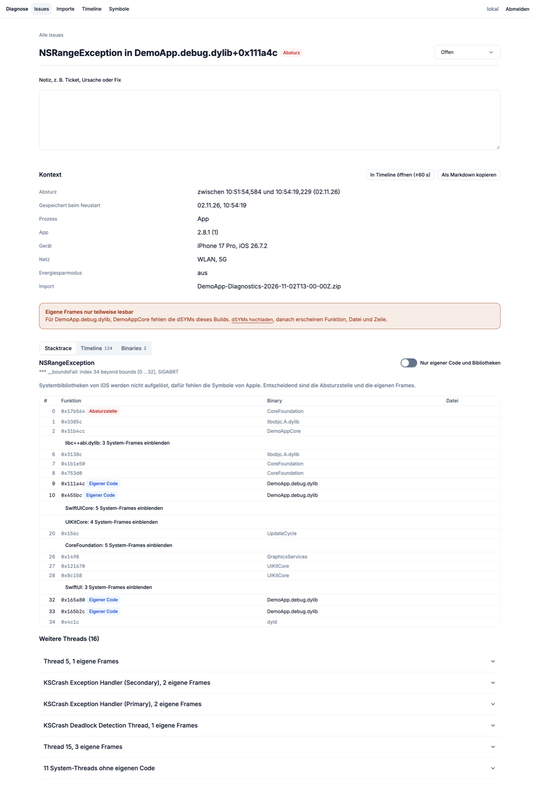
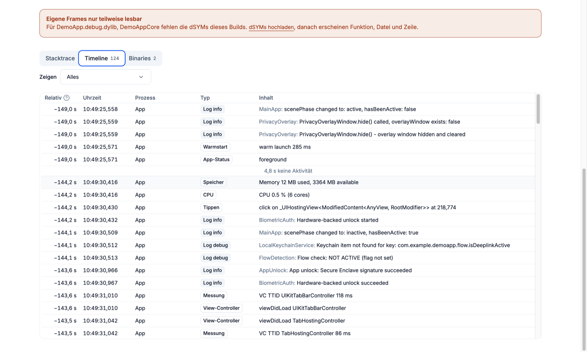
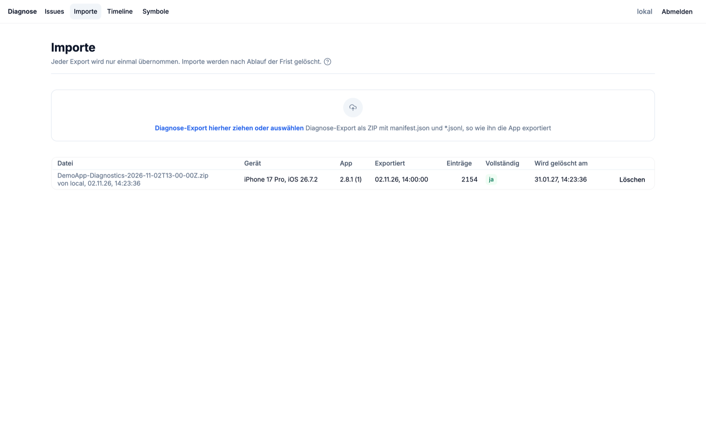

# measure-local-diagnostics

Import und Auswertung von Diagnose-Exporten, die eine App lokal mit dem [Measure](https://github.com/measure-sh/measure)-SDK sammelt: Abstürze, Hänger, der Verlauf vor dem Fehler und Symbolisierung.

Gedacht für Apps, die keine Diagnosedaten an einen Server schicken dürfen. Die App fängt die Uploads von Measure auf dem Gerät ab, schreibt sie in JSONL-Dateien und gibt sie nur über einen Export frei, den die Nutzerin oder der Nutzer selbst anstößt. Dieses Werkzeug liest solche Exporte ein und macht sie auswertbar. Unterstützt werden derzeit iOS-Exporte, Android ist geplant.



## Funktionen

- **Import** von Exporten per Drag & Drop. Doppelte Exporte und überlappende Einträge werden erkannt.
- **Issues**: Abstürze und Hänger werden über die obersten eigenen Frames gruppiert. Pro Issue gibt es Status und Notiz.
- **Vorkommen**:
  - Kontext: Gerät, OS, App-Version, Netz, Prozess (App oder Extension).
  - Absturz-Thread mit eigenen Frames, Bibliotheken und System-Frames getrennt markiert, dazu alle weiteren Threads.
  - Verlauf der Session vor dem Fehler: Taps, View-Controller, HTTP, Logs, CPU, Speicher, Lücken ohne Aktivität.
  - Export als Markdown für Tickets.
- **Symbolisierung**: dSYM-ZIP hochladen. Gespeichert wird nur die kompakte SymCache, Swift-Namen werden lesbar gemacht.
- **Timeline-Suche** über alle Einträge, die Filter stehen in der URL.
- **Löschfrist**: Importe werden nach `RETENTION_DAYS` (Standard 90) automatisch gelöscht.

| Absturz mit Stack | Verlauf vor dem Absturz |
|---|---|
|  |  |



Die Screenshots zeigen Demodaten aus absichtlich eingebauten Fehlern, ohne hochgeladene dSYMs.

## Exportformat

Ein Export ist ein ZIP mit einem Ordner, darin `manifest.json` und eine oder mehrere `*.jsonl`-Dateien. Jede Zeile ist ein JSON-Objekt:

```json
{"process":"app","kind":"app_log","timestamp":"2026-11-02T09:54:19.120Z","level":"error","category":"Sync","message":"…"}
{"process":"app","kind":"event","data":{"type":"exception","session_id":"…","exception":{"exceptions":[…],"threads":[…],"binary_images":[…]}}}
{"process":"autofill","kind":"span","data":{"name":"…","start_time":"…","duration":42}}
```

- `kind: event` enthält Measure-Events unverändert (`exception`, `app_hang`, `gesture_click`, `http`, `lifecycle_*`, `cold_launch`, …).
- `process` unterscheidet App und Extension.
- `manifest.json` nennt mindestens `app_version`, `app_build`, `bundle_id`, `exported_at` und `files`.

## Aufbau

| Teil | Technik |
|---|---|
| `api/` | FastAPI, Postgres, `symbolic` 10.2.1 (letzte Version mit Swift-Demangling) |
| `web/` | React, Vite, [`@getitdone-gmbh/kette-design-community`](https://www.npmjs.com/package/@getitdone-gmbh/kette-design-community), Login per OIDC (Keycloak, PKCE) |
| `tools/` | Upload der dSYMs neuer Xcode-Archive |

## Lokal starten

```bash
cd api && python3.12 -m venv .venv && .venv/bin/pip install -r requirements-dev.txt
.venv/bin/python -m pytest -q tests        # nutzt ein eingebettetes Postgres (pgserver)
DATABASE_URL=postgresql://… AUTH_DISABLED=1 .venv/bin/uvicorn app.main:app --port 8000
cd ../web && npm install && npm run build && PORT=8080 API_URL=http://localhost:8000 npm start
```

Ohne `OIDC_ISSUER` läuft die Web-App ohne Login. Die API braucht dafür `AUTH_DISABLED=1`, das ist nur für die lokale Entwicklung gedacht.

## Betrieb

| Variable | Dienst | Bedeutung |
|---|---|---|
| `DATABASE_URL` | api | Postgres-Verbindung |
| `OIDC_ISSUER`, `OIDC_CLIENT_ID` | api, web | Login; die API prüft das Token gegen den Issuer |
| `WEB_ORIGIN` | api | erlaubte Herkunft für CORS |
| `RETENTION_DAYS` | api | Löschfrist für Importe, Standard 90 |
| `MAX_UPLOAD_MB` | api | Größenlimit für Exporte und dSYMs |
| `SYMBOLS_UPLOAD_TOKEN` | api | Schlüssel, mit dem `tools/upload-dsyms.sh` ohne Login dSYMs hochladen darf |
| `API_URL` | web | Adresse der API |

`itdone.yaml` ist eine Beispielkonfiguration für [itdone.cloud](https://itdone.cloud) mit Postgres- und Keycloak-Add-on.

## dSYMs automatisch hochladen

Ein LaunchAgent auf dem Mac lädt die dSYMs jedes neuen Xcode-Archivs hoch. Im App-Repo und im Xcode-Projekt ändert sich dafür nichts.

```bash
DIAGNOSTICS_API_URL=https://… DIAGNOSTICS_UPLOAD_TOKEN=… DIAGNOSTICS_BUNDLE_ID_PATTERN='com.example.*' \
  tools/install-archive-watcher.sh                  # installieren
tools/install-archive-watcher.sh --uninstall        # entfernen
tools/upload-dsyms.sh <Pfad/zum/Archiv.xcarchive>   # einzelnes Archiv nachreichen
```

- `tools/archive-watcher.swift` beobachtet `~/Library/Developer/Xcode/Archives` per FSEvents. Sobald Xcode die `Info.plist` eines Archivs schreibt (das passiert zuletzt), lädt `upload-dsyms.sh` dessen `dSYMs` mit Version, Build und Archivzeit hoch.
- Die Einstellungen landen in `~/Library/Application Support/measure-local-diagnostics/config`, nur für den eigenen Benutzer lesbar. Umgebungsvariablen haben Vorrang.
- `DIAGNOSTICS_BUNDLE_ID_PATTERN` ist ein Shell-Muster. Ohne Angabe werden alle Archive hochgeladen.
- Bereits hochgeladene Archive stehen in `uploaded-archives.txt` im selben Ordner, das Log in `~/Library/Logs/measure-local-diagnostics-archive-watcher.log`.

## Datenschutz

Exporte enthalten Logs, Gerätedaten und den Verlauf einer Session. Echte Exporte gehören nicht in dieses Repo. Ein Test mit echten Daten läuft nur lokal: `LOCAL_EXPORT=<zip> LOCAL_DSYMS=<ordner> pytest`.

## Lizenz

[Apache-2.0](LICENSE)
