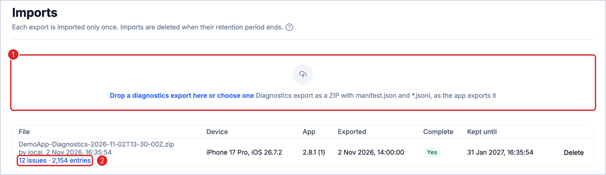
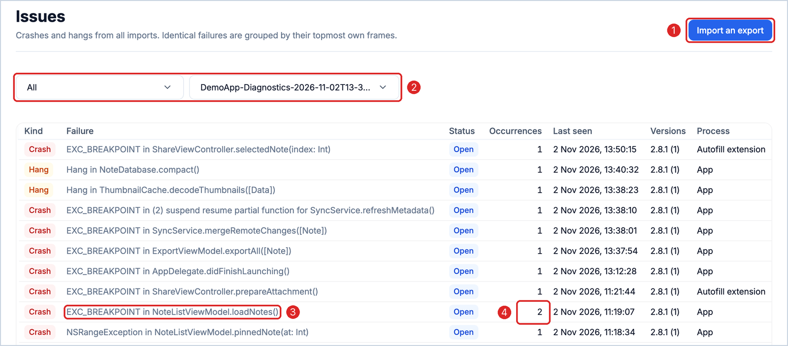
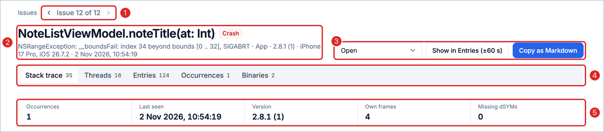
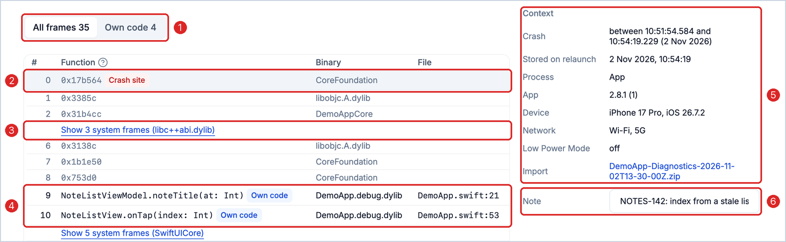
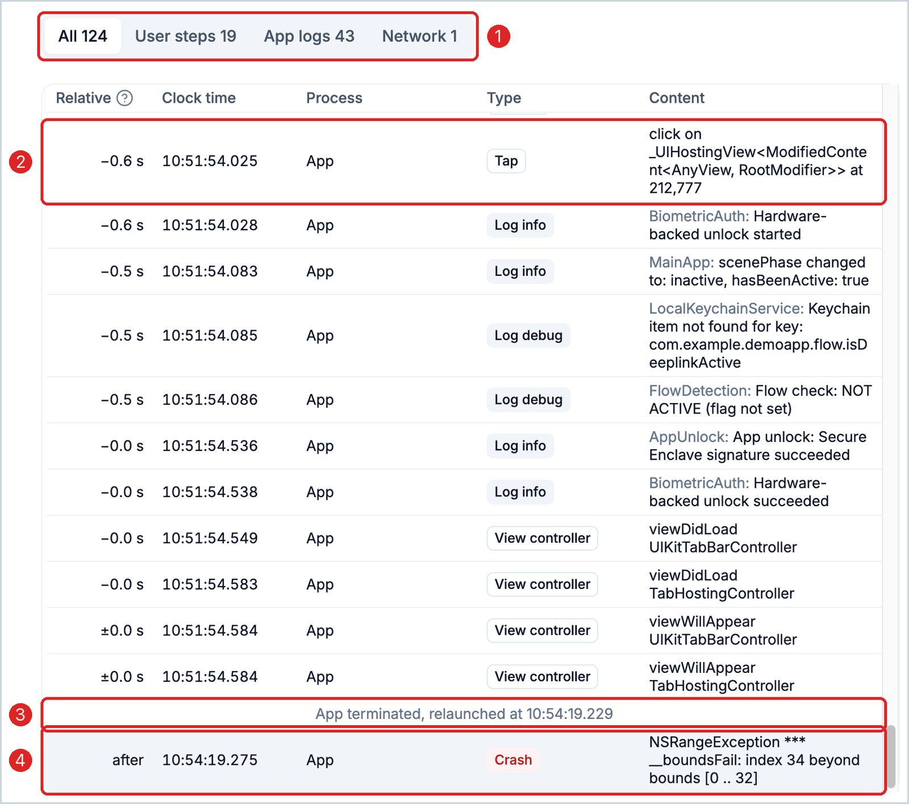

# measure-local-diagnostics

Import and analysis of diagnostics exports that an app collects locally with the [Measure](https://github.com/measure-sh/measure) SDK: crashes, hangs, what happened before the failure, and symbolication.

Built for apps that must not send diagnostics data to a server. The app intercepts Measure's uploads on the device, writes them to JSONL files and releases them only through an export that the user starts themselves. This tool reads such exports and makes them analysable. iOS exports are supported today, Android is planned.

## Features

- **Import** of exports by drag and drop. Duplicate exports and overlapping entries are detected.
- **Issues**: crashes and hangs are grouped by their topmost own frames. Each issue has a status and a note.
- **Occurrences**:
  - Context: device, OS, app version, network, process (app or extension).
  - Crashed thread with own frames, libraries and system frames marked separately, plus all other threads.
  - Entries of the session before the failure: taps, view controllers, HTTP, logs, CPU, memory, gaps without activity.
  - Export as Markdown for tickets.
- **Symbolication**: upload a dSYM ZIP. Only the compact SymCache is stored, Swift names are made readable.
- **Entries**: search and filters across all lines of all imports, the filters live in the URL.
- **Retention**: imports are deleted automatically after `RETENTION_DAYS` (default 90).

## How to read a crash

The screenshots show demo data from a small notes app with uploaded dSYMs.

### 1. Import an export



1. Drag the export ZIP from the app here. Each export is imported only once, overlapping exports from the same device complement each other.
2. Each row shows what the export brought in: the issues and all entries of this import, both linked directly.

### 2. Choose an issue



1. Further exports are added on the Imports page.
2. Filter by status and import. After an upload the list shows every status of the new export, so a failure that came back does not stay hidden.
3. Identical failures are grouped into one issue, named after the failure type and the topmost own frame.
4. How often the failure occurred, across all imports.

### 3. Issue overview



1. Previous and next through the list, keeping its filter.
2. The location as the heading, below it failure type, reason, process, version, device and time.
3. Set the status, open the entries around the crash, copy the occurrence as Markdown for a ticket.
4. Stack trace, all threads, the entries of the session, all occurrences and the binaries, each with a count.
5. Key figures across all occurrences.

### 4. Stack and context



1. Switch between all frames and own code only.
2. The crash site is highlighted. iOS system frames stay addresses because Apple's symbols are not available.
3. Longer runs of system frames are collapsed.
4. Own code with function, file and line as soon as the dSYMs of the build are uploaded.
5. Context of the selected occurrence: time range of the crash, process, version, device, network and the import it came from.
6. Note on the issue, for example a ticket or the cause. It is saved on Enter or when leaving the field.

### 5. What happened before



1. Filter by user steps, app logs or network.
2. Each row with the offset to the crash, clock time, process and type, here the last tap before the crash.
3. A crash is only stored on the next launch. The gap until then is marked as a relaunch, not as a hang.
4. The crash itself, with its reason.

On a phone, context and key figures are behind the "Details" button.

## Export format

An export is a ZIP with one folder containing `manifest.json` and one or more `*.jsonl` files. Each line is a JSON object:

```json
{"process":"app","kind":"app_log","timestamp":"2026-11-02T09:54:19.120Z","level":"error","category":"Sync","message":"…"}
{"process":"app","kind":"event","data":{"type":"exception","session_id":"…","exception":{"exceptions":[…],"threads":[…],"binary_images":[…]}}}
{"process":"autofill","kind":"span","data":{"name":"…","start_time":"…","duration":42}}
```

- `kind: event` contains Measure events unchanged (`exception`, `app_hang`, `gesture_click`, `http`, `lifecycle_*`, `cold_launch`, …).
- `process` distinguishes app and extension.
- `manifest.json` names at least `app_version`, `app_build`, `bundle_id`, `exported_at` and `files`.

## Architecture

| Part | Technology |
|---|---|
| `api/` | FastAPI, Postgres, `symbolic` 10.2.1 (last version with Swift demangling) |
| `web/` | React, Vite, [`@getitdone-gmbh/kette-design-community`](https://www.npmjs.com/package/@getitdone-gmbh/kette-design-community), sign-in via OIDC (Keycloak, PKCE) |
| `tools/` | Upload of the dSYMs of new Xcode archives |

## Run locally

```bash
cd api && python3.12 -m venv .venv && .venv/bin/pip install -r requirements-dev.txt
.venv/bin/python -m pytest -q tests        # uses an embedded Postgres (pgserver)
DATABASE_URL=postgresql://… AUTH_DISABLED=1 .venv/bin/uvicorn app.main:app --port 8000
cd ../web && npm install && npm run build && PORT=8080 API_URL=http://localhost:8000 npm start
```

Without `OIDC_ISSUER` the web app runs without sign-in. The API then needs `AUTH_DISABLED=1`, which is meant for local development only.

## Operation

| Variable | Service | Meaning |
|---|---|---|
| `DATABASE_URL` | api | Postgres connection |
| `OIDC_ISSUER`, `OIDC_CLIENT_ID` | api, web | Sign-in; the API checks the token against the issuer |
| `WEB_ORIGIN` | api | Allowed origin for CORS |
| `RETENTION_DAYS` | api | Retention period for imports, default 90 |
| `MAX_UPLOAD_MB` | api | Size limit for exports and dSYMs |
| `SYMBOLS_UPLOAD_TOKEN` | api | Key that lets `tools/upload-dsyms.sh` upload dSYMs without signing in |
| `API_URL` | web | Address of the API |

`itdone.yaml` is an example configuration for [itdone.cloud](https://itdone.cloud) with Postgres and Keycloak add-ons.

## Upload dSYMs automatically

A LaunchAgent on the Mac uploads the dSYMs of every new Xcode archive. Nothing changes in the app repo or the Xcode project.

```bash
DIAGNOSTICS_API_URL=https://… DIAGNOSTICS_UPLOAD_TOKEN=… DIAGNOSTICS_BUNDLE_ID_PATTERN='com.example.*' \
  tools/install-archive-watcher.sh                  # install
tools/install-archive-watcher.sh --uninstall        # remove
tools/upload-dsyms.sh <path/to/archive.xcarchive>   # upload a single archive later
```

- `tools/archive-watcher.swift` watches `~/Library/Developer/Xcode/Archives` via FSEvents. As soon as Xcode writes an archive's `Info.plist` (that happens last), `upload-dsyms.sh` uploads its `dSYMs` with version, build and archive time.
- The settings are stored in `~/Library/Application Support/measure-local-diagnostics/config`, readable only by your own user. Environment variables take precedence.
- `DIAGNOSTICS_BUNDLE_ID_PATTERN` is a shell pattern. Without it, all archives are uploaded.
- Archives already uploaded are listed in `uploaded-archives.txt` in the same folder, the log is in `~/Library/Logs/measure-local-diagnostics-archive-watcher.log`.

## Privacy

Exports contain logs, device data and the history of a session. Real exports do not belong in this repo. A test with real data runs only locally: `LOCAL_EXPORT=<zip> LOCAL_DSYMS=<folder> pytest`.

## License

[Apache-2.0](LICENSE)
